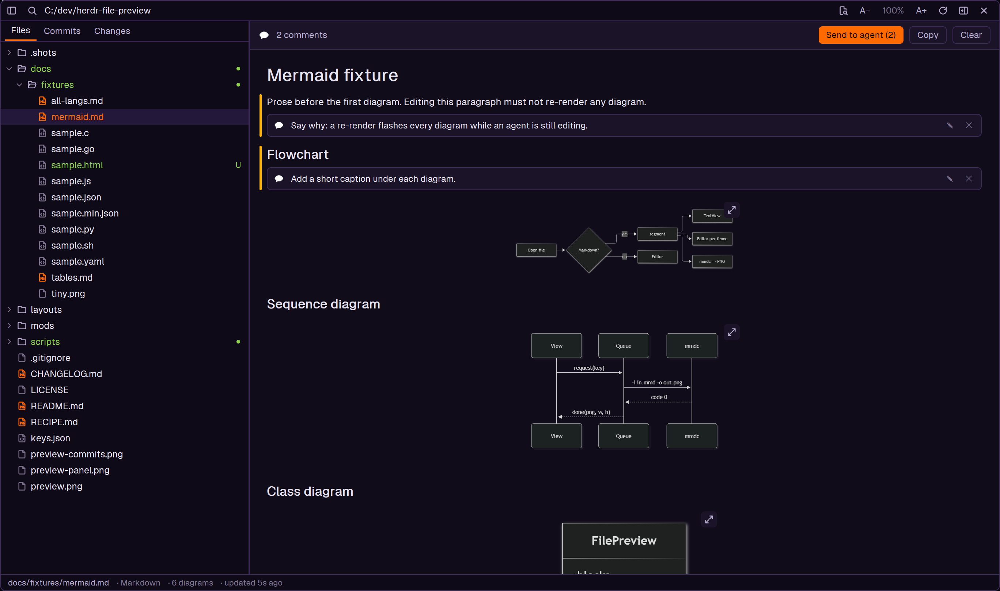
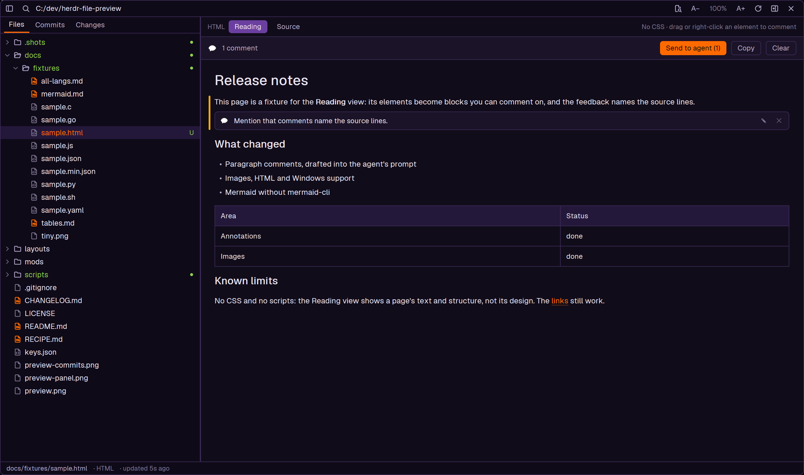

# file-preview

A [Herdr](https://herdr.dev) layout (`main-fp`) and the mods behind it: a file tree of the
focused terminal's folder next to a rendered preview of the selected file: Markdown with highlighted code fences,
Mermaid diagrams and pictures, HTML, images, plus syntax-highlighted source files. You can
**comment on paragraphs and hand the comments to the agent in that tab** as a draft to
review, and **edit a file in place** (with a live preview beside Markdown and HTML). It works in local and remote spaces, on macOS, Linux and Windows, reloads live
while agents edit files, and opens as a side panel on the right of the window (a Preview
button next to Files and Changes) or as a near-full-screen popup.

This is a fork of [bborrero14/herdr-file-preview](https://github.com/bborrero14/herdr-file-preview)
(MIT). The fork adds paragraph comments with Send to agent, images, HTML, Windows support
and Mermaid without mermaid-cli; everything else is the original's.




## Features

- **File tree** of the focused terminal's working directory. Folders load lazily when
  you expand them. All dotfiles are shown except `.git`. The tree is capped at 500
  entries per folder and 5000 in total.
- **Follows the focused terminal.** Focus another terminal or `cd`, and the root moves
  with it. Focusing the preview itself, or another mod, keeps the last root, so the
  panel doesn't jump when you click into it.
- **Choose the root by hand.** The top bar shows the root as a breadcrumb: click any folder
  in it to make that folder the root, up to `/` or a drive (`C:/`). **↑** (or `Backspace` in
  the tree) goes up one folder, and `.` on a selected folder makes it the root. While you've
  chosen a root, the preview stops following the terminal; **↺** follows it again. Commands:
  `file-preview.root-up`, `file-preview.root:<absolute path>`, `file-preview.root-follow`
  (bind them in `keys.json` if you like).
- **Markdown**: CommonMark + GFM (tables, task lists, quotes, strikethrough, links).
  Relative links to `.md` files open inside the mod, and external links open in your
  browser (local spaces only). A paragraph that is only pictures (``,
  ``) shows them as images; see **Images**.
- **Paragraph comments.** Drag across a paragraph (a heading, a list, a table, a picture)
  and click **+ Comment**, or right-click it. Type, then **Ctrl/Cmd+Enter** or **Comment**.
  A commented paragraph gets a bar in the margin and its comments under it, each with
  **✎** (edit) and **✕** (delete). Comments belong to a paragraph, not to selected words:
  Herdr gives a mod no access to the text you select. They are kept on this computer in
  `~/.config/herdr-app/data/file-preview/comments.json`, per machine and file, with the
  paragraph's text and first line, so they find their paragraph again after the file is
  edited (a paragraph that's gone keeps its comment, marked as such in the feedback).
- **Send to agent: a draft you review.** A bar over a commented file shows the count and
  three buttons:
  - **Send to agent (N)** pastes the comments into the prompt of the agent in the shown
    tab (on the file's machine), **without pressing Enter**, so you read and edit them
    there first. With several agents there, a small picker asks which; with none, use Copy.
    It works through the clipboard (copy, focus that terminal, paste), so the feedback
    stays on the clipboard. Comments sent this way are dimmed with **✓ drafted**, and the
    next Send carries only the new ones.
  - **Copy** puts the same feedback on the clipboard.
  - **Clear** deletes the file's comments.

  The feedback is numbered Markdown, in document order:

  ```markdown
  # Feedback on README.md

  File: spark:/home/me/project/README.md
  2 comments. Each one is about the quoted paragraph.

  ## Annotation 1 — README.md (line 8, section "Install")
  Comment on: "Copy the mods into Herdr. Copy them; don't symlink."
  > Say why symlinks break the icons.
  ```
- **Images.** Image files in the tree (PNG, JPEG, GIF, WebP, SVG, BMP, ICO) show fitted to
  the preview, with their size, local or remote. Pictures inside Markdown and HTML show in
  place too, but only image files under the folder you browse: a document can't make the
  mod read anything else. A picture is copied once into the mod's cache (remote ones
  through herdr-core as base64, nothing else to set up) and its size comes from its header.
  Web images aren't fetched.
  - **View over SSH** (remote image files): shows the picture the way terminal file
    managers like yazi do, with Kitty graphics in a short-lived terminal on that machine,
    so nothing is copied. PNG needs only `python3` there; other formats need `chafa` or
    ImageMagick. Enter closes it.
- **HTML**: `.html` files open in a **Reading** view: the page's elements (headings,
  paragraphs, lists, tables, pictures) as blocks you can comment on, like Markdown, and
  the feedback names their source lines. Scripts, styles and comments are left out, and
  layout wrappers (`<div id="app">`, `<main>`, …) are opened up. Herdr draws HTML without
  CSS, so you see the page's text and structure, not its design. **Source** shows the code.

  
- **Editing.** **✎ Edit** in the top bar, or `e` (in the tree: the selected file), turns the
  preview into an editor on the file's text, with line numbers (and highlighting in code
  files).
  - **Save** (`ctrl-s` / `cmd-s`) writes the file and keeps you editing; **Cancel** (`Esc`)
    goes back to the preview, asking first if there are unsaved changes. Opening another
    file, changing the root, opening a commit or closing with **✕** asks the same.
  - **Markdown and HTML** get a live preview of what you type: **Split** (side by side,
    in the popup), **Source** or **Preview**. Diagrams render as you go. The HTML preview
    is the Reading view (no CSS); there is no WYSIWYG editing.
  - **Agents can't be overwritten by accident.** A save only goes through while the file
    is still what you started from. If an agent changed it meanwhile, a banner offers
    **Use theirs** (take the disk's text) or **Keep mine** (save over it). An untouched
    editor simply follows the file as it changes.
  - **Remote files** save through the same connection the preview reads with: the text
    goes over as base64 in pieces into a temporary file next to the original, then one
    step checks the file is unchanged (`cksum`), and renames the new text into place,
    keeping its permissions. A symlink is written through, not replaced. The remote
    machine needs `base64` (standard on Linux and macOS).
  - Line endings are kept (a CRLF file stays CRLF). Files over 1 MB, binary files,
    images and files shown as of a commit can't be edited.
  - If the view closes without asking (`Esc` in the tree, the open/close key), your
    unsaved text is kept and comes back the next time you edit that file, as long as the
    file hasn't changed since.
- **Windows**: local folders work through Git for Windows' `sh` (its `stat`, `find`,
  `head` and `git`), which the mod finds by itself; remote folders work as from macOS.
  Windows line endings (CRLF) are read correctly.
- **Highlighted code fences** in Markdown, one read-only editor per fence, sized to
  its text. Each fence has a header with its language and a **copy button** that puts
  the fence's content on the clipboard ("Copied" confirms it). The wheel over a fence
  scrolls the document, not the fence.
- **Mermaid diagrams**: ` ```mermaid ` fences are rendered to PNG locally and cached:
  with mermaid-cli when it's installed, otherwise with a browser already on the machine
  (Edge, Chrome or Chromium) and the mermaid.js that ships with the mod, so nothing needs
  installing (always the browser on Windows). If neither works, you see the diagram
  source with a notice and a Retry button.
- **Expanded diagrams**: the expand button in a diagram's top-right corner opens it
  fitted to the whole view, with zoom (`+`, `-`, `0` for fit), the zoom level and
  scrollbars on both axes. Zooming past the cached image's resolution renders a sharper
  copy (at twice the pixels) in the background and swaps it in. In the popup it covers
  the popup; from the side panel it opens as a dialog over the window.
- **Reading zoom** from 70 % to 200 %: one level scales the Markdown prose (headings,
  tables and inline code too), code fences, the code view and diagrams together; the bars
  and the tree keep their size. Use `+` / `-` / `0`, or **A−** / **A+** in the top bar
  (click the percentage to reset). The popup remembers its level; the side panel keeps one
  per tab (a tab never zoomed shows 100 %), like its width.
- **The popup and the side panel remember each folder.** Per root folder (and machine),
  they keep the open file and the expanded folders, and bring them back the next time they
  show that root, also after a Herdr restart: the folders reopen, the file shows again and the
  tree's cursor sits on it, scrolled into view. A file or folder that no longer exists is
  skipped, and a root seen for the first time starts clean. When the root follows the
  terminal while the popup is open, the old root's state is saved and the new one's
  restored. The last 20 roots are kept (up to 200 expanded folders each), in the
  `file-preview.memory` shared value.
- **Hide the file tree** at any width with the sidebar button at the top left or `b`.
  The popup and the side panel each remember the choice.
- **Code view** with syntax highlighting for JavaScript/TypeScript, Bash/sh/zsh, Python,
  C, Go, JSON (also jsonc, jsonl, ndjson, json5, geojson) and YAML (also yml, and TOML
  as an approximation). JSON is always soft-wrapped, so minified one-line files are
  readable. Other text files are shown as plain text.
- **Two modes**: a side panel and a popup that covers 95 % of the window.
  - The side panel is the right column of the `main-fp` layout, the same one as Herdr's
    Files and Changes panels. The **Preview** button at the top right of the tab bar
    opens and closes it, and the terminals of the tab (all their splits) shrink to make
    room. Drag its left edge to resize it: the width is kept per tab, so each tab (in any
    space) has its own, and a tab never resized starts at 368 px. Which panel is open is
    remembered per space.
  - The side panel shows one page at a time, at its full width: the Files, Commits and
    Changes list, or what you open from it (a file, a commit, a change), with a
    **← Files** (or Commits, Changes) bar to go back. `Esc` or `Tab` also goes back. The
    popup keeps the sidebar and the preview side by side.
  - The side panel's expand button turns it into the popup, on the same file. Closing that
    popup (`Esc`, ✕, `cmd-shift-e` or its anchor button) brings the side panel back.
  - Opening the side panel (Preview, `cmd-e`, the popup's anchor) moves the keyboard
    to it, so its keys work without a click.
- **Remote spaces**: the tree, file reads and live reload all work on remote Unix
  machines. Diagrams are always rendered on the local machine.
- **Git changes, VS Code style.** Inside a git repository (local or remote), the tree
  colors changed files and gives each a letter, and folders with changes below them get
  a dot. Code files mark what changed against `HEAD` (staged and unstaged together); Markdown
  documents get no marks (the Changes tab shows their diff):
  - An overview ruler on the right edge: the whole file's changes at a glance.
  - Up to 1,000 lines, also a gutter left of the line numbers, line by line (longer files
    and soft-wrapped JSON have only the ruler).

  | Mark | Meaning | Color |
  |---|---|---|
  | `M` | modified | yellow (`ansi3`) |
  | `A` | added to the index, or renamed (shown on the new name) | green (`ansi2`) |
  | `U` | untracked | green (`ansi2`) |
  | `!` | merge conflict | red (`ansi1`) |
  | `●` on a folder | something below it changed (the strongest color wins) | as above |
  | bar | added lines / modified lines | green / blue (`ansi4`) |
  | ▸ | lines deleted here | red |

  Deleted files aren't in the tree, so they get no mark; ignored files are left alone.
  Outside a repository, or without git, nothing is drawn. The marks refresh with live
  reload and every 5 s while the mod is open.
- **Find a file**: `/` or `cmd-f` in the tree (or the magnifier next to the sidebar
  button) opens a search field over the tree. It fuzzy-matches the whole relative path,
  ignoring case (`samjs` finds `sample.js`). Letters in the file name, runs of adjacent
  letters and word starts rank higher. Up to 200 results replace the tree, best first,
  with the matched letters highlighted and git letters shown. `↑` `↓` move, `Enter` opens
  the file (the field keeps the keyboard), and `Esc` closes the search and reveals the
  opened file in the tree. Inside a git repository the list is
  `git ls-files --cached --others --exclude-standard` (ignored files are left out);
  elsewhere it is `find` (skips `.git`, 12 levels deep, at most 20,000 files). It works on
  remote spaces, is listed once per root and refreshes when the tree changes.
- **Find in the document**: `/` or `cmd-f` in the preview (or the document magnifier in
  the top bar) opens a find bar with a match count ("6 matches in 3 blocks") and previous /
  next buttons. Matching is a case-insensitive substring over the file's source (prose,
  fences and Mermaid sources). **It marks matches but can't scroll to them** (see
  Limitations), so it tells you where the current one is, in the status bar:
  `Find: match 3 of 12 · line 82 · <section heading>`.
  - Markdown: each match in the prose is highlighted in the theme's accent, the current
    one stronger; a bar in the right margin marks each block with matches and the current
    block is framed. Matches inside code spans, link targets, raw HTML or centered and
    right-aligned table cells, or that span Markdown syntax, aren't highlighted (the bar
    still counts them). Lines with matches inside a code fence are tinted.
  - Code files: matching lines are tinted in the line-aligned layout (repository files up
    to 1,000 lines); otherwise each match is a mark on an overview strip at the right edge.
  - `Enter` / `↓` / `n` go to the next match (a line in a code file), `shift-Enter` / `↑` /
    `shift-n` to the previous one, `Esc` closes the bar. The search survives live reload
    and is cleared when you open another file.
- **Commit history** (GitLab-style graph). Inside a git repository the sidebar has three
  tabs, **Files | Commits | Changes**; the choice is remembered separately for the popup and
  the side panel, and the tabs are hidden outside a repository. In the popup, drag the
  sidebar's edge to resize it: each tab (and the narrow view) keeps its own width.

  

  - The Commits tab lists `git log --topo-order` of every branch, tag and remote ref plus
    `HEAD` (stashes are left out), 300 commits at a time; the next page loads when you
    scroll or move near the end, or with the "Load more" row. Two controls on top, both
    remembered:
    - The **All branches | Current branch** switch, both labels inside it and the chosen
      one lit. Current branch is `git log HEAD`.
    - The **Remotes** button, next to it. On All branches it adds every remote branch; on
      Current branch, the branch's upstream (`git log HEAD @{u}`), so commits not pulled or
      pushed yet show too. Off, no remote branches, neither their commits nor their
      `origin/...` flags.
  - Each row has the graph cell (one colored lane per branch, curves where branches fork
    and merge, a node per commit, a ring for merges, an outlined node for `HEAD`), ref
    labels GitLab-style at the node (a flag pointing at it, in the lane's color: branches
    filled, ◆ tags outlined, remotes dimmed, the checked-out branch bold, `main ⇄ origin`
    when a branch and its remote agree; every ref is shown, the checked-out branch first, then
    main/master/develop, other branches and tags, newest version first; flags that don't fit are cut at the
    row's edge and hide that row's subject), the subject, and, when the sidebar is at least 360 px wide, the author and a short
    relative date. Up to 10 lanes are drawn (6 in a narrow sidebar).
  - Click a commit, or `Enter` on it, to show it in the preview: subject, refs, full hash
    with a copy button, author and email, absolute and relative date, clickable parents,
    the message body rendered as Markdown, the changed files with status letters
    (A/M/D/R) and `+`/`−` counts, and the diff of each file with tinted added, removed
    and hunk-header lines, and the old and new line numbers on the left (GitLab style).
    Merges show the diff against their first parent.
  - Click a changed file (in the list or a diff header) to open it **as of that commit**
    through the normal preview (Markdown, Mermaid, highlighting, zoom), under a banner
    "at <hash> · <path> · <subject> · ← back to commit". A deleted file opens as of the
    commit's parent. Relative links in such a document open their target in the same
    commit. `Backspace` or the banner button goes back to the commit.
  - The list refreshes when a ref moves (commit, checkout, branch, tag, fetch): the mod
    compares a checksum of `HEAD` and every ref on each git refresh, and keeps the
    selected commit by hash. Works on remote spaces.
- **Uncommitted changes.** The Changes tab lists what `git status` reports under the root,
  in three sections: **Staged**, **Unstaged** and **Untracked** (a file staged and then
  edited again is in both of the first two), each row with its status letter and folder.
  Click a file, or `Enter` on it, to show its diff in the preview: the index against `HEAD`
  for Staged, the working tree against the index for Unstaged, the whole file as added for
  Untracked; like a commit's diff, it has the old and new line numbers on the left.
  "Open file" shows the file itself. The list and the open diff refresh with the
  git status (every 5 s and on file changes); a diff whose change is gone says so. Read-only:
  nothing is staged or committed. Works on remote spaces.
- **Live reload**: the open file and the expanded folders update as files change. Local
  spaces use a file watcher. Remote spaces poll: every 2.5 s for the open file and every
  10 s for the tree.
- **Limits**: files over 1 MB are truncated with a notice, and binary files show
  "Binary file · no preview".
- Uses your Herdr theme colors (light and dark), including for syntax highlighting.

## Requirements

- **Herdr app** on macOS, Linux or Windows. Remote spaces need a Unix machine with `sh`
  and `stat`.
- **Windows, for local folders:** [Git for Windows](https://git-scm.com/download/win)
  (its `sh.exe` in `C:\Program Files\Git\usr\bin`). Remote folders don't need it.
- **Optional, for git change marks and the commit history:** `git` on the machine that holds
  the files (2.31 or later for merge diffs against the first parent).
- **Optional, for Mermaid diagrams:** either of
  - **Nothing to install**: Microsoft Edge, Google Chrome or Chromium on this machine. The
    mod draws diagrams with it and its own `vendor/mermaid.min.js` (mermaid 12.3.0, MIT).
    This is the only way on Windows, and the fallback elsewhere.
  - [`@mermaid-js/mermaid-cli`](https://github.com/mermaid-js/mermaid-cli) (`mmdc`):
    `npm install -g @mermaid-js/mermaid-cli`
  - **Google Chrome or Chromium** (Brave and Edge also work). `mmdc` installs no
    browser here: the mod finds one and passes it to puppeteer. It checks
    `$PUPPETEER_EXECUTABLE_PATH`, `/Applications` and `~/Applications` on macOS, and
    `google-chrome`, `google-chrome-stable`, `chromium` and `chromium-browser` on Linux.

  > **About `PATH`.** Programs started by a mod get a minimal `PATH`, without Homebrew
  > or Node version managers. The mod looks for `mmdc` in this order:
  > 1. The `MMDC` constant at the top of `mods/file-preview/mermaid.js`, if you set it
  >    to an absolute path.
  > 2. **fnm's default alias**: `~/.local/share/fnm/aliases/default/bin/mmdc`. If you
  >    use fnm, install mermaid-cli under the Node version that is your fnm default.
  > 3. The minimal `PATH`.
  > 4. A login shell: `fish -lic` or `$SHELL -lic`, then `command -v mmdc`.
  >
  > With nvm, volta or another manager, set `MMDC` to the absolute path of `mmdc`.

Without mermaid-cli and without a browser everything else works, and diagrams appear as
source code.

### What the mod runs and reads

As the herdr.dev guidance asks, here is what the mod does outside its own folder:

- It **runs programs** with `exec`: `sh` (folder listings, `stat`, file probes, `base64`
  and `cp` for pictures, and read-only `git rev-parse`, `git status`, `git diff`,
  `git log`, `git show`, `git cat-file` and `git for-each-ref`, which never write under
  `.git`); on Windows that `sh` is Git for Windows' own. For Mermaid: `node` with `mmdc`,
  which starts headless Chrome, or a headless Edge / Chrome directly. `open` or `xdg-open`
  for links you click. Login shells are only used to look up `mmdc`.
- **Only when you ask:** **Send to agent** copies the feedback to the clipboard, focuses
  the agent's terminal and pastes it (never Enter); **View over SSH** starts a terminal on
  that machine (`hc run`) that prints the picture with `python3`, `chafa` or ImageMagick.
- It **reads files anywhere** under the folder you browse, on local or remote machines.
- It **writes only** to `~/.config/herdr-app/mods/file-preview/.cache/` (rendered
  diagrams, cached pictures, the puppeteer config and the browser's profile) and
  `~/.config/herdr-app/data/file-preview/comments.json` (your comments).
- It makes **no network requests**: no content leaves your machine.

### Security

Opening a file never runs it and never installs anything. What a hostile file could
still reach, and how the mod keeps it out:

- **Git**: a folder can carry its own `.git/config` (a downloaded folder can; `git clone`
  doesn't copy it). Every git call forces `core.fsmonitor=false`,
  `log.showSignature=false` and `gpg.program=false`, diffs use `--no-ext-diff
  --no-textconv`, and the clean, smudge and process commands of every `filter` that
  config defines are blanked first (`git status` would otherwise run them on each file it
  re-hashes), in the folder and in its submodules (nested ones too), so that config can't
  name a program for git to run.
- **Markdown and HTML** are drawn by Herdr's own renderer: no JavaScript, no CSS, no
  network. Links open only when you click them.
- **Pictures in documents** load only when they are image files under the folder you
  browse, so `` doesn't copy your key into the cache.
- **Mermaid** is the one place a file's text reaches a JavaScript engine, automatically:
  mermaid runs with `securityLevel: "strict"` in a headless browser with its own profile,
  on pages whose Content-Security-Policy allows no network and no file reads.
- **View over SSH** on a non-PNG image runs `chafa` or ImageMagick, which have had bugs
  with crafted images: use it on pictures you trust.
- **Send to agent** quotes each paragraph's first line, which a file could word to steer
  the agent. It's a draft: read it before you press Enter.

## Install

1. Copy the mods into Herdr. **Copy them; don't symlink.** With a symlinked mod folder,
   the mod loads but its SVG icons don't draw.

   ```sh
   scripts/sync.sh     # rsync mods/* -> ~/.config/herdr-app/mods/ (or $HERDR_APP_HOME/mods/)
   ```

   This installs three mods and a layout: `file-preview` (the viewer),
   `file-preview-panel` (a tiny launcher that opens or closes the side panel), `tabs-fp`
   and `layouts/main-fp.json`. The script removes any old symlink first. It also refuses
   to run if the two copies of `dock.js` differ.

2. Switch to the `main-fp` layout (Settings, or the command below). It is a clone of
   Herdr's `main` layout (0.1.12) with file-preview added to the right panel, and its tab
   bar is `tabs-fp`, a clone of Herdr's `tabs` with the Preview button. Herdr's own
   layouts and mods are read-only, so the clones are the only way to add the button.
   They don't get Herdr's updates of `main` and `tabs`. Without `main-fp`, `cmd-e`
   opens the popup instead.

   ```sh
   herdr-app do layout.switch '{"name":"main-fp"}'
   ```

3. Merge the shortcuts from [`keys.json`](keys.json) into `~/.config/herdr-app/keys.json`:

   ```json
   {
     "global": {
       "cmd-e": "mod.open:file-preview-panel",
       "cmd-shift-e": "mod.open:file-preview"
     }
   }
   ```

4. Optional: run `herdr-app check` on `~/.config/herdr-app/mods/file-preview`,
   `file-preview-panel` and `tabs-fp`.

## Updating

Herdr doesn't update layouts or mods you installed from herdr.dev or GitHub: your copy
stays as it was the day you added it. Each version is a git tag, listed with its changes
in [`CHANGELOG.md`](CHANGELOG.md). To hear about new ones, watch the repo on GitHub
(Watch → Custom → Releases).

To update, replace the installed copies; don't add the repo again. An agent adding it
again finds the names taken and installs a renamed second copy next to yours.

- **From a clone of this repo:** `git pull`, then `scripts/sync.sh`. It replaces the
  three mod folders and `layouts/main-fp.json` in place.
- **With Herdr's agent:** ask it to *replace* the installed `file-preview`,
  `file-preview-panel`, `tabs-fp` and `layouts/main-fp.json` with the ones from
  `https://github.com/evilsquid888/herdr-file-preview`, keeping the names.
- **On Windows** (no `rsync`): copy `mods/file-preview`, `mods/file-preview-panel` and
  `mods/tabs-fp` over the folders in `%USERPROFILE%\.config\herdr-app\mods\`, leaving out
  `jsconfig.json` and `gpui-kit.d.ts`, and `layouts/main-fp.json` into `layouts\`.

Your shortcuts, panel widths, zoom levels and remembered files survive an update: they
live in `keys.json` and Herdr's state, not in the mod folders. If a version's notes list
a `keys.json` change, merge it by hand.

If you edited the installed files, the update overwrites them. Clone the mod under a new
name first (`herdr-app do mod.clone '{"name":"file-preview","as":"my-file-preview"}'`) to
keep your version.

## Shortcuts

| Key | Action |
|---|---|
| `cmd-e` | Open or close the side panel (the Preview button's hover shows this key) |
| `cmd-shift-e` | Open or close the popup |

On Windows and Linux, `ctrl-e` and `ctrl-shift-e` often mean something already (end of
line in shells, Herdr's split down), so pick free keys there, for example:

```json
{ "global": { "alt-e": "mod.open:file-preview-panel", "alt-shift-e": "mod.open:file-preview" } }
```

Comments:

| Action | How |
|---|---|
| Comment on a paragraph | Drag across it, then **+ Comment**; or right-click it |
| Save a comment | `ctrl-Enter` / `cmd-Enter`, or **Comment** (Enter makes a new line) |
| Edit / delete a comment | **✎** / **✕** on it |
| Hand the comments to the agent | **Send to agent** (a draft in its prompt: you press Enter) |

Inside the mod:

| Key | Action |
|---|---|
| `↑` `↓` | Move in the tree (`Home`, `End`, `PageUp`, `PageDown` too) |
| `→` | Expand a folder, or step into it |
| `←` | Collapse a folder, or go to its parent |
| `Enter` / `Space` | Open the file, or toggle the folder |
| `Tab` | Switch focus between the tree and the preview (side panel: open the list's page, or go back to it) |
| `r` | Reload the tree and the file |
| `Backspace` | Root up one folder (tree focused) |
| `.` | Make the selected folder the root (tree focused) |
| `/` or `cmd-f` | Find a file (tree focused) or find in the document (preview focused) |
| `n` / `shift-n` | Next / previous match while the document search is open (preview focused) |
| `e` | Edit the shown file (preview focused) or the selected file (tree focused) |
| `b` | Hide or show the file tree (popup) |
| `g` | Switch the sidebar from Files to Commits, and from Commits or Changes back to Files (in a git repository) |
| `Backspace` | Back to the commit from a file shown as of that commit (preview focused) |
| `+` (or `=`) / `-` | Reading zoom in / out (70 % to 200 %; the popup keeps one level, the side panel one per tab) |
| `0` | Reading zoom back to 100 % |
| `Esc` | Close the popup; in the side panel, back to the list from what it opened |

In the Commits and Changes tabs, `↑` `↓` `PageUp` `PageDown` `Home` `End` move the selection
and `Enter` (or `Space`) shows the selected commit or change; `Tab`, `r`, `b` and `g` work as
in the tree.

In a search field (keys typed there never trigger the shortcuts above):

| Key | Action |
|---|---|
| `↑` `↓` (`PageUp` `PageDown`) | File search: move in the results. Document search: previous / next match |
| `Enter` | File search: open the selected file. Document search: next match |
| `shift-Enter` | Document search: previous match |
| `Esc` | Close the search only (the popup stays open) |

While editing (keys go to the editor; the shortcuts above are off in it):

| Key | Action |
|---|---|
| `ctrl-s` / `cmd-s` | Save, and keep editing |
| `Esc` | Cancel: back to the preview (asks first with unsaved changes); on the question, Keep editing |

In an expanded diagram:

| Key | Action |
|---|---|
| `+` (or `=`) / `-` | Zoom in / out (steps of 1.25×) |
| `0` | Back to fit |
| `Esc` | Close the expanded diagram (the popup stays open) |

The top bar also has buttons for the tree, file search, document search, reading zoom (A−, the percentage, A+), edit (✎),
reload, anchor (popup only: back to the side panel), expand (side panel only: open
as the popup) and close. An expanded diagram's bar has zoom out, zoom in, fit and close.

## Limitations

- The side panel shares its column with Files and Changes: one of the three shows at a
  time, at the tab's width (368 px at first; drag it up to 1,600 px).
- Long lines in a code fence (other than JSON, which wraps) scroll sideways with the
  trackpad, but the fence shows no horizontal scrollbar.
- An expanded diagram scrolls with the wheel, the trackpad or its scrollbars; there is
  no drag to pan, and zooming doesn't keep the point under the pointer in place.
  The sharper render is capped at `-s 4`, so past 200 % (the percentage shown) the
  image is upscaled a little.
- Above 100 % reading zoom, diagrams in the document are the cached `-s 2` image scaled
  up, so they are a little soft; the expanded view renders a sharper copy.
- **Document search marks matches but doesn't scroll to them.** Herdr can only scroll
  virtual lists from a script, not the document, so the find bar and status bar tell you
  the match, line and section of the current one instead. Words are highlighted only in
  Markdown prose (through `<mark>`); editors expose no highlight or selection API, so code
  fences and code files get per-line marks. The current match's paragraph gets a frame.
- File search lists at most 50,000 files in a git repository and 20,000 elsewhere.
- **Editing:** Herdr gives a mod no way to focus its editor or read the cursor, so click
  into the text to start typing, and there are no "insert at cursor" buttons (bold, link).
  Clicking a paragraph in the preview doesn't jump to its source. Comments are made in the
  normal preview, not while editing. A remote save takes one call per 24 KB of base64
  (about 50 for a 1 MB file), and its unchanged-file check compares a CRC and the size.
- Leaving an expanded diagram in the popup puts the document back at its top: Herdr
  can't read or restore a scroll position.
- **The popup's memory doesn't keep the document's scroll position**, for the same
  reason: a reopened file starts at its top. Searches aren't remembered either.
- Remote spaces must be Unix. Local folders on Windows need Git for Windows.
- Mermaid needs Chrome, Chromium or Edge on the local machine. Each diagram renders once
  (about 1–2 s; with mermaid-cli about 1 s warm, 5 s cold) and is cached by content and theme.
- **Git marks on Markdown are per paragraph**: a deletion inside a paragraph shows at its top.
- **Comments are per paragraph, not per word**: Herdr gives a mod no access to the
  selected text. The Source view of an HTML file takes no comments (make them in Reading).
- **Send to agent pastes, it doesn't type**: Claude Code may fold a long paste into
  `[Pasted text +N lines]`; read the comments in the bar first, or use Copy.
- **Pictures** are copied up to 6 MB each; only a paragraph made only of pictures shows
  them (a picture inside a sentence or a table cell stays alt text).
- **Code files over 1,000 lines get the ruler, not the gutter.** The gutter needs the
  editor laid out at full height, which costs about 16 ms per frame at 1,000 lines and
  45 ms at 2,000. In a repository, a code file up to that size scrolls as a whole page:
  its horizontal scrollbar is hidden (scroll sideways with the trackpad), and moving the
  cursor with the keyboard doesn't scroll the view.
- **Commit history:** pages use `--skip`, so each "Load more" re-walks the history in
  topological order; on very large repositories (hundreds of thousands of commits) the
  first page itself can take seconds. A commit's diff is capped at 1,000 lines per file
  and 3,000 per commit (and 2 MB of patch), with "Diff truncated" notes; diff lines are
  plain text (Herdr's editor has no diff highlighting) with tinted backgrounds, and long
  lines scroll sideways with the trackpad only. Lanes past the 10th (6th in a narrow
  sidebar) aren't drawn; such a commit's node sits, hollow, on the last column. The graph
  column is as wide as the widest part of the loaded history. There is no search,
  checkout, cherry-pick or blame: the history is read-only.
- Git marks compare with `HEAD` only; there is no inline diff, blame or staging. A
  repository with more than 20,000 changed or untracked files shows the first 20,000.
- PDF and CSV-as-table are out of scope. The mod never changes your files: comments
  live in its own data file.

## Troubleshooting

- **A yellow notice on a diagram** ("Install @mermaid-js/mermaid-cli…" or "Mermaid needs
  Google Chrome or Chromium") means the mod couldn't find `mmdc` or a browser. Install
  the missing piece and press **Retry** on the notice. If `mmdc` still isn't found, set
  `MMDC` in `mermaid.js` (see Requirements) and rerun `scripts/sync.sh`.
- **A red notice on a diagram** shows mermaid's error, which usually means a syntax
  error in the diagram. Fix the source; **Retry** renders it again. The browser renderer
  logs each step to `~/.config/herdr-app/mods/file-preview/.cache/mermaid.log`.
- **"Local folders on Windows need Git for Windows"**: install it (see Requirements) and
  press **Retry**.
- **Send to agent does nothing visible**: the agent's terminal must be on the file's
  machine; with no agent there, the bar says so. The text is also on the clipboard.
- **"Cannot reach <machine>"** in the tree: the remote machine is offline. The last
  loaded tree stays visible. Press **Retry** when the machine is back.
- **Nothing happens, or the mod looks broken:** run `herdr-app status` and look at
  `errors`, then run `herdr-app check ~/.config/herdr-app/mods/file-preview` (and
  `file-preview-panel`, `tabs-fp`).
- **No Preview button in the tab bar:** the shown layout isn't `main-fp`. Switch to it
  (see Install); without it `cmd-e` opens the popup.
- **Icons are missing:** the mod folder is probably a symlink. Remove it and install
  with `scripts/sync.sh`.

## Repository layout

```
mods/file-preview/         the viewer (main.js, tree.js, source.js, markdown.js, lang.js, git.js, commits.js, graph.js, find.js, memory.js, mermaid.js, zoom.js, dock.js, icons/)
                           plus annotate.js (comments, feedback), images.js (pictures, View over SSH),
                           html.js (Reading view), shell.js (sh, Git for Windows), vendor/ (mermaid.min.js, MIT)
mods/file-preview-panel/   launcher for the side panel (main.js, dock.js copy)
mods/tabs-fp/              Herdr's tab bar (tabs 0.1.12) plus the Preview button and the per-tab panel width
layouts/main-fp.json       Herdr's main layout (0.1.12) with file-preview in the right panel
scripts/sync.sh            install / update into ~/.config/herdr-app/mods/ and layouts/
scripts/make-big-md.sh     generates docs/fixtures/big.md (> 1 MB, not versioned)
docs/fixtures/             test documents: every language, Mermaid, tables, HTML, binary
keys.json                  shortcut snippet to merge
RECIPE.md                  brief for rebuilding the mods and the layout from scratch
CHANGELOG.md               changes in each tagged version
LICENSE                    MIT
```

## License

[MIT](LICENSE)
